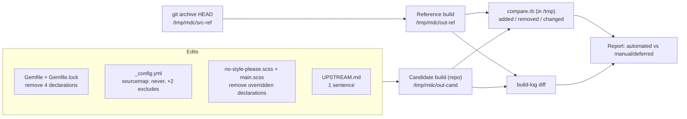

# Design Document: minimal-dependencies-cleanup

## Overview

A small cleanup with four edits and one verification pass:

1. `Gemfile` / `Gemfile.lock`: drop the direct `webrick` declaration and the Windows-only `tzinfo`, `tzinfo-data` and `wdm` declarations. Nothing else in the lockfile changes.
2. `_config.yml`: add `sourcemap: never` under `sass`, and exclude `assets/fonts/README.md` and `assets/fonts/SOURCE.txt`.
3. `_sass/no-style-please.scss` and `assets/css/main.scss`: remove baseline declarations that `main.scss` provably overrides, plus the `hr` pseudo-element content pair and its neutralizer.
4. `vendor/no-style-please/UPSTREAM.md`: one sentence describing the stylesheet adaptation.

The three plugins (jekyll-seo-tag 2.9.0, jekyll-sitemap 1.4.0, jekyll-paginate 1.1.0) stay as gems. Layouts, includes, search files, `pages.yml`, `package.ps1`, `.ruby-version` and `.kiro/steering/` are not touched. The published output must be identical to a HEAD reference build except for the Allowed_Differences.

### Findings that shape the design

Checked by reading the repository files and the jekyll-sass-converter docs:

- `Gemfile` declares `webrick "~> 1.8"` in `group :development`, and the three Windows helpers under a `# Windows helpers` comment with `platforms:` restrictions. The lockfile resolves `webrick (1.9.2)` as a spec, and `jekyll (4.4.1)` depends on `webrick (~> 1.7)`. So the `webrick` spec and checksum stay after the direct declaration is removed. `tzinfo`, `tzinfo-data` and `wdm` have no specs or checksums in the lockfile, because no locked platform matches them. Only their `DEPENDENCIES` lines exist.
- jekyll-sass-converter generates source maps by default (`sourcemap` defaults to `always`). `never` disables them entirely ([jekyll-sass-converter README](https://github.com/jekyll/jekyll-sass-converter#source-maps)).
- Jekyll `exclude` entries are paths relative to the source root. The existing `README.md` entry therefore matches only the root file, and `assets/fonts/README.md` and `assets/fonts/SOURCE.txt` are currently published.
- `assets/css/main.scss` starts with `@use "no-style-please";`, so all baseline rules compile before every `main.scss` rule. Neither file uses `!important`. Every override listed below is a top-level rule (no media query) in both files.
- `_includes/head.html` links `main.css` without a hash or version query. Changing the CSS bytes does not change any HTML.
- Working tree at design time: HEAD `e72e13b06b0c619c6cb1c6913dda2825bdc726d0`. Unstaged deletions: nine files under `assets/icons/` (the User_Deleted_Icons). Modified: `.kiro/steering/*.md`. Untracked: `.kiro/specs/`. `.kiro` is excluded from the build, so only the icons affect output.
- The Theme_Baseline has no header attribution comment. Its only comment explains the `html, body` background rule. Attribution lives in the file name, `vendor/no-style-please/` (UPSTREAM.md, LICENSE.txt) and `DEPENDENCIES.md`. None of these change.
- `README.md`, `DEPENDENCIES.md` and `UPSTREAM.md` do not mention `webrick`, `tzinfo`, `wdm` or source maps. `DEPENDENCIES.md` refers to the plugins as "Jekyll plugins and transitive gems" with `Gemfile`/`Gemfile.lock`. That stays valid and needs no edit.

## Architecture



All agent-run builds happen in WSL Debian with `JEKYLL_ENV=production`, an external `--destination` under `/tmp/mdc/` and `--disable-disk-cache`. Nothing is written to `_site/`, `dist/`, `.jekyll-cache/` or other Protected_Files.

## Components and Interfaces

### 1. Gem manifest

`Gemfile`: remove these lines (the `development` group becomes empty, so it is removed too):

```ruby
group :development do
  gem "webrick", "~> 1.8"
end

# Windows helpers
gem "tzinfo", ">= 1", "< 3", platforms: [:mingw, :x64_mingw, :mswin, :jruby]
gem "tzinfo-data", platforms: [:mingw, :x64_mingw, :mswin, :jruby]
gem "wdm", "~> 0.1", platforms: [:mingw, :x64_mingw, :mswin]
```

The remaining `Gemfile` keeps `source`, `gem "jekyll", "~> 4.4.1"` and the `:jekyll_plugins` group with the three pinned plugins, unchanged. Blank lines around removed blocks are trimmed so the file ends with the `end` of the plugin group plus a newline.

`Gemfile.lock`: in `DEPENDENCIES`, remove exactly:

```text
  tzinfo (>= 1, < 3)
  tzinfo-data
  wdm (~> 0.1)
  webrick (~> 1.8)
```

`GEM`/`specs` (including `webrick (1.9.2)`), `PLATFORMS`, `CHECKSUMS` and `BUNDLED WITH 4.0.11` stay byte-identical. The lockfile is edited by hand, not by `bundle lock` or `bundle install`. Bundler then validates it instead of regenerating it.

Validation (WSL Debian, repository root):

```bash
sha256sum Gemfile.lock > /tmp/mdc/lock.before
BUNDLE_FROZEN=true bundle check
BUNDLE_FROZEN=true bundle exec jekyll --version
sha256sum -c /tmp/mdc/lock.before          # lockfile not rewritten
git diff -U0 -- Gemfile.lock               # only the 4 "-" lines above
```

If `bundle check` reports a mismatch, stop and report it. Do not let Bundler re-resolve.

### 2. `_config.yml`

```yaml
sass:
  style: compressed
  sourcemap: never
```

Append two entries to `exclude` (placed after `README.md`, the last entry). All other entries, `plugins`, `keep_files` and every other key stay as they are. No `assets/icons/` entry is added.

```yaml
  - assets/fonts/README.md
  - assets/fonts/SOURCE.txt
```

### 3. Stylesheets

Rule for removal: a baseline declaration is removed only if `main.scss` has a later declaration that matches on selector item, property (or a shorthand that fully resets it), media context, specificity and importance. Anything else stays.

| Baseline rule | Removed | Overridden by (`main.scss`) | Kept in baseline |
|---|---|---|---|
| `html, body` | `background` (with its comment) | `html, body { background: var(--background) }` | rule removed |
| `html` | `scroll-behavior: smooth` | `html { scroll-behavior: auto }` | `height: 100%` |
| `body` | `color`, `font-family`, `font-size`, `line-height` | `body { color; font-family; font-size: 17px; line-height }` | `margin`, `min-height`, `overflow-wrap` |
| `.post-meta` | `text-align: right` | `.post-meta { text-align: left }` | rule removed |
| `hr` (first) | `margin: 2rem 0` | `hr { margin: 2rem 0 }` | rule removed |
| `*:target` | `background: yellow` | `*:target { background: transparent }` | rule removed |
| `.w` | `max-width`, `padding` | `.w { max-width: 1024px; padding: 2.5rem 2rem 1.5rem }` | `margin: 0 auto` |
| `hr` (second) | `&:before`, `&:after` content (Req 3.2) | removed together with the neutralizer | `text-align`, `border: 0` |
| `code` | `color`, `background` | `code { background; color }` | rule removed |
| `div.highlighter-rouge code` | `display`, `white-space`, `padding` | `pre code, div.highlighter-rouge code { display; padding; white-space }` (same item, specificity 0,1,2) | `overflow-x: auto` |
| `blockquote` | `font-style`, `border` | `blockquote { border: 0; font-style: normal }` (`border: 0` resets the whole shorthand) | `padding`, nested `p { margin: 0 }` |

`main.scss`: remove only `hr::before, hr::after { content: none; }`. With no `content` on either side, `::before`/`::after` compute to `content: normal`, which generates no box. That matches the current rendering, where the boxes exist but are empty.

Kept as uncertain or not overridden: `h2, h3, h4, h5, h6 { margin-top }` (only partly overridden, and only inside `.prose` or specific containers), `p`/`li` margins, `table { width }`, `table, th, td` (only `border-color` is overridden; `th, td` padding is overridden but `table` padding is not), `img`, `hr { text-align; border: 0 }` (`border: 0` still removes the default side borders).

The baseline keeps its name, its `@use` entry point and its remaining upstream rules. The palette variables, the three `@font-face` blocks with `font-display: swap` and the 480/700/767px media queries are in `main.scss` and stay untouched.

### 4. Documentation

`vendor/no-style-please/UPSTREAM.md`, line 8: extend "with the inversion-based theme switcher removed" so it also says that declarations overridden by `assets/css/main.scss` were removed. No other doc edits are needed: no doc mentions the removed gem declarations or source maps, and `DEPENDENCIES.md` keeps pointing to `Gemfile`/`Gemfile.lock` for the plugins.

### 5. Comparison step

A disposable Ruby stdlib script at `/tmp/mdc/compare.rb`, outside the repository, so no repo file or exclusion is added. Inputs: `out-ref`, `out-cand`. Output and exit code:

- Lists added, removed and changed paths (SHA-256 per file).
- `search.json`: compared as `JSON.parse` values. Other files: compared byte for byte.
- Classifies each difference as one of:
  - Allowed: changed `assets/css/main.css`, removed `assets/css/main.css.map`, removed `assets/fonts/README.md`, removed `assets/fonts/SOURCE.txt`.
  - Pre-existing user change: removed `assets/icons/*` (expected 9 files).
  - Unexpected: anything else, including any HTML, `sitemap.xml` or `robots.txt` difference. The script exits non-zero.
- Prints `main.css` byte sizes for both builds, and checks the required tokens and absences listed under Correctness Properties.

## Data Models

None. The only structured data involved is the existing build output: a file tree, plus `search.json` as a JSON array.

## Correctness Properties

*A property is a characteristic or behavior that should hold true across all valid executions of a system-essentially, a formal statement about what the system should do. Properties serve as the bridge between human-readable specifications and machine-verifiable correctness guarantees.*

These are checked once against the real reference and candidate builds by the comparison step and shell checks. No property-based testing library is used.

### Property 1: Output equivalence modulo allowed differences

For every path in the union of the reference and candidate output trees, the file is identical in both (`search.json` equal as parsed JSON), unless the path is one of the four Allowed_Differences or one of the pre-existing `assets/icons/` deletions. This includes all HTML (with SEO metadata), `sitemap.xml`, `robots.txt` and the three license files.

**Validates: Requirements 1.3, 3.4, 4.1, 4.2, 4.5, 5.3, 5.4**

### Property 2: Lockfile change is removal-only

For every line of HEAD `Gemfile.lock`, the line is present in the candidate lockfile unless it is one of the four allowed `DEPENDENCIES` lines. The candidate adds no lines, and its SHA-256 does not change during the frozen `bundle check` and build.

**Validates: Requirements 2.1, 2.3, 2.4, 2.5**

### Property 3: Compiled stylesheet is smaller and keeps required tokens

For every token in {`#0d1320`, `#090e17`, `#dce4f5`, `#a2aec4`, `#7ba5ff`, `#252c38`, `Fira Sans`, `font-display:swap`, `480px`, `700px`, `767px` (each inside an `@media` max-width query), `FiraSans-Regular.woff2`, `FiraSans-Bold.woff2`, `FiraSans-Italic.woff2`}, the candidate `main.css` contains it. The candidate contains neither `sourceMappingURL` nor any `hr:before`/`hr::before`/`hr:after`/`hr::after` selector, and its byte size is smaller than the reference.

**Validates: Requirements 3.2, 3.3, 3.4, 3.5**

## Error Handling

- Frozen bundle check fails, or the lockfile hash changes: stop, restore `Gemfile.lock` to the hand-edited version (only the four removals versus HEAD), and report. Do not run `bundle install` or `bundle lock` to make it pass.
- Comparison reports an Unexpected difference: treat it as a regression. Revert the stylesheet or config change that caused it (CSS candidates fall back to "keep"), rebuild, compare again.
- A `main.css` declaration diff shows a change not in the table above: keep the baseline declaration.
- New warning in the candidate build log: investigate before reporting. Build logs are diffed after dropping the timing (`done in`), `Source:` and `Destination:` lines.
- Reference build fails: report it and do not proceed. A broken reference cannot prove equivalence.

## Testing Strategy

PBT does not apply. This is a configuration, manifest and CSS change with no new logic, and the requirements rule out a PBT framework, a fake DOM and new dependencies (Req 5.5). Verification is the production build plus one comparison.

Automated, agent-run (WSL Debian; repo at `/mnt/d/Projects/blog`; same `BUNDLE_PATH` as the repo's bundle config):

1. Reference, before any edit: record `git rev-parse HEAD`, `git status --short` and `git diff --stat`. Then `git archive HEAD | tar -x -C /tmp/mdc/src-ref`, and in it run `JEKYLL_ENV=production BUNDLE_FROZEN=true bundle exec jekyll build -d /tmp/mdc/out-ref --disable-disk-cache 2>&1 | tee /tmp/mdc/ref.log`.
2. Implement the edits above.
3. Manifest check (Component 1).
4. Candidate: from the repo, run the same build with `-d /tmp/mdc/out-cand`, logging to `/tmp/mdc/cand.log`.
5. `ruby /tmp/mdc/compare.rb /tmp/mdc/out-ref /tmp/mdc/out-cand` (Properties 1 and 3).
6. Build-log diff (Req 5.2).
7. Focused CSS review: split both `main.css` files on `}` and `diff`. Confirm that every removed declaration is in the table and that nothing else changed. Report before/after byte sizes and the `main.css.map` removal.
8. Scope check: `git status --short` and `git diff --stat` show changes only in `Gemfile`, `Gemfile.lock`, `_config.yml`, the two stylesheets and `UPSTREAM.md`. The icons are still deleted and unstaged. No new `_plugins/`, SEO include, sitemap/robots template or vendored plugin copy exists.
9. Clean up `/tmp/mdc/`.

Manual or deferred, reported as unverified until done:

- Visual equivalence across all Page_Kinds at desktop and below 768px (owner).
- CI run on Ubuntu 24.04 with `BUNDLE_FROZEN=true` (pending until an authorized push or workflow run).
- `bundle exec jekyll serve` and `.\package.ps1` (owner, because they write `_site/`, `.jekyll-cache/` and `dist/`).

No commit, push or deploy. The report claims no page-load or install-time improvements.
